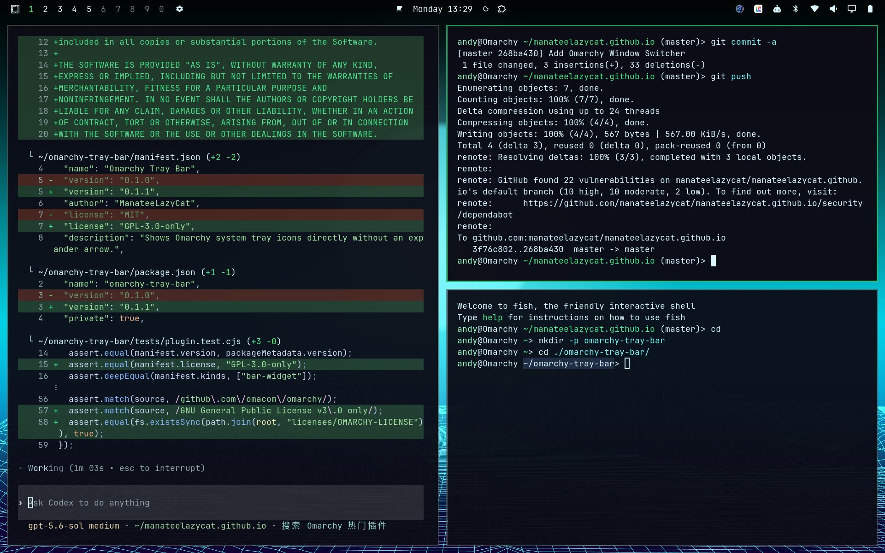

# Omarchy Tray Bar

简体中文 | [English](README.md)



一个 Omarchy 状态栏插件：直接显示所有未隐藏的系统托盘图标，无需展开箭头或悬停展开操作。

## 功能

- 托盘图标默认展开并保持可见。
- 不显示展开箭头，也不为箭头预留空间。
- 不会在悬停时折叠。
- 抽屉中没有项目时，不占用空白空间。
- 支持水平和垂直的 Omarchy 状态栏。
- 启用后自动替换内置的 `omarchy.tray` 组件。

## 安装

```bash
omarchy plugin add https://github.com/manateelazycat/omarchy-tray-bar.git --enable --yes
```

无需手动修改 `~/.config/omarchy/shell.json` 或插件源码。

## 更新

```bash
omarchy plugin update io.github.manateelazycat.tray-bar --yes
```

## 卸载

```bash
omarchy plugin remove io.github.manateelazycat.tray-bar --yes
```

卸载插件后会恢复 Omarchy 内置的系统托盘。

## 开发

```bash
omarchy plugin validate .
npm test
```

## 致谢

本插件基于 [Omarchy](https://github.com/omacom/omarchy) 的系统托盘实现；原始 MIT 协议保存在 [licenses/OMARCHY-LICENSE](licenses/OMARCHY-LICENSE)。详见 [THIRD_PARTY_NOTICES.md](THIRD_PARTY_NOTICES.md)。

## 协议

仅按 GNU General Public License v3.0 发布。详见 [LICENSE](LICENSE)。
